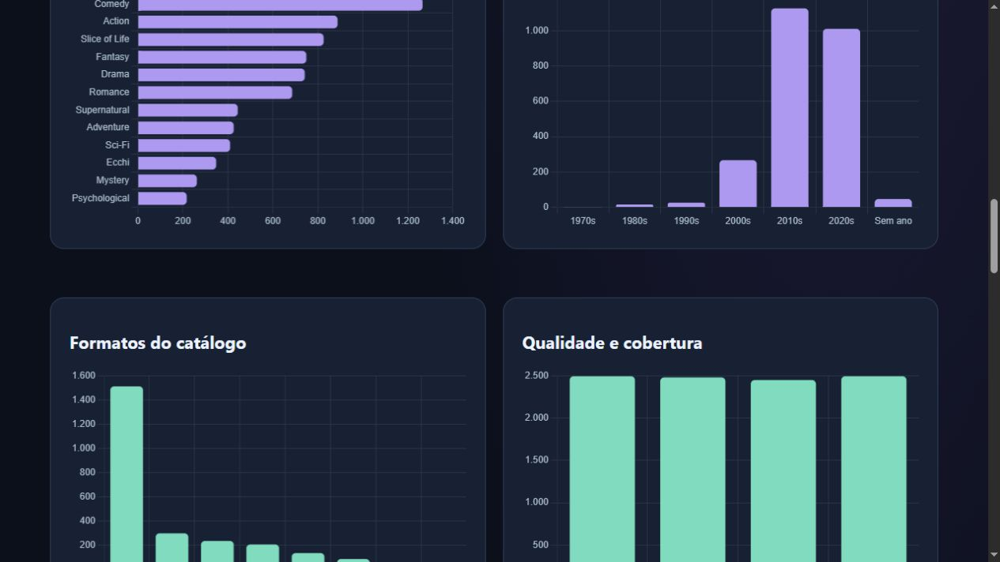
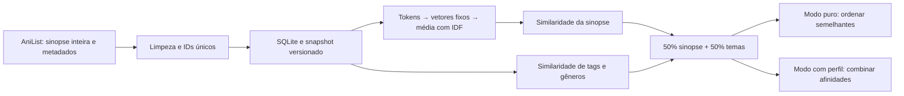

# AniRec — recomendação de animes por Recuperação da Informação

**Pesquise um anime. Encontre obras parecidas. Personalize apenas se quiser.**

Projeto acadêmico de TCC com sinopses completas e metadados do AniList, vetores estáticos pré-calculados e ranking determinístico. O aplicativo não treina modelos, não usa classificadores e não chama LLMs.

**[Abrir o site](https://Lucas-LMS.github.io/anirec-tcc/)** · **[Explorar o dataset](https://Lucas-LMS.github.io/anirec-tcc/dataset.html)** · **[Comparar modelos](https://Lucas-LMS.github.io/anirec-tcc/laboratorio.html)** · [Documentação técnica](recomendador/docs/)



## Experimente em dois modos

| Modo | O que informar | O que participa do ranking |
|---|---|---|
| **Só animes parecidos — recomendação pura** | Apenas o anime de referência | Sinopse inteira e temas da obra. Ignora notas, histórico, favoritos, interesses, exclusões e obras ocultadas do perfil. É o modo inicial, inclusive quando já existe perfil salvo. |
| **Com minhas preferências** | Interesses e favoritos opcionais, ou lista pública do AniList | Geral mantém exclusões pessoais; Para mim combina a obra pesquisada com afinidades do perfil. Duas listas: todas as obras e apenas não iniciadas. |

O modo puro não apaga seu perfil. Você pode voltar à personalização a qualquer momento. Regras gerais de catálogo, como obras não adultas e filtro opcional de lançamentos, são distintas de preferências pessoais.

### O que já funciona

- Busca por título e recomendação automática ao escolher a referência no modo puro.
- Cadastro opcional em três passos: gêneros, tags e favoritos, sem notas obrigatórias.
- Importação completa de lista **pública** do AniList, respeitando paginação e limites da API.
- Escala individual de notas: ponto neutro entre menor e maior nota observadas.
- Sinopse inteira em inglês; tags e gêneros com pesos explicáveis.
- Funil de candidatos, motivos de exclusão, parcelas do score e movimento Geral → Para mim.
- Ampliação de descobertas sob demanda e diversificação heurística por nomes, opcional.
- Julgamentos de relevância exportáveis; sem treinamento ou alteração automática do ranking.
- Atlas com filtros, gráficos, sinopses, consultas SQL auditadas e download do banco público.
- Laboratório que alterna entre quatro representações estáticas no mesmo catálogo congelado.

## Rodar em qualquer máquina: site local

Requer apenas **Python 3**. Não precisa de conta, chave, Node, compilação ou instalação de modelos para experimentar a versão estática.

```bash
git clone https://github.com/Lucas-LMS/anirec-tcc.git
cd anirec-tcc
python -m http.server 8000 --bind 127.0.0.1 --directory site
```

Abra **http://127.0.0.1:8000/**. No Windows, pode usar `py -3` em vez de `python`. Para encerrar, pressione `Ctrl+C` no terminal.

Os arquivos necessários já estão em `site/`: catálogo, vetores fragmentados, interface, gráficos e banco público. O perfil dessa execução fica **no armazenamento deste navegador e endereço**, separado de outros visitantes. O código principal roda no navegador. A importação, novas buscas e capas precisam de internet; as recomendações sobre o catálogo já carregado usam cálculo local. O primeiro carregamento do codificador de novas sinopses pode baixar cerca de 30 MB; depois ele é reutilizado durante a sessão.

Não abra `index.html` diretamente por `file://`: os arquivos de dados são carregados por HTTP. Também é possível usar um servidor estático equivalente.

## Rodar o servidor Python de pesquisa

Esta opção utiliza SQLite e perfil privados na máquina, além do mesmo frontend. Recomendado **Python 3.12**.

```bash
python -m venv .venv
# Linux/macOS:
source .venv/bin/activate
# Windows PowerShell: .venv\Scripts\Activate.ps1
python -m pip install -r requirements.txt
python recomendador/initialize_local.py
python recomendador/server.py --port 8765
```

Abra **http://127.0.0.1:8765/**. O perfil e o banco operacional ficam, por padrão, em `~/tcc-lab/recomendador-private`, **fora deste repositório**. `initialize_local.py` preserva um snapshot existente e não sobrescreve perfis.

Variáveis opcionais:

| Variável | Finalidade |
|---|---|
| `ANIREC_DATA_DIR` | Diretório privado para perfil, SQLite e snapshot operacional |
| `ANIREC_WORD2VEC_PATH` | Caminho de um `.model` Gensim compatível; se ausente, utiliza os mesmos vetores públicos fragmentados incluídos no projeto |

Os iniciadores `recomendador/iniciar.ps1` e `iniciar.sh` preservam a configuração histórica WSL da máquina de desenvolvimento. Para uma instalação nova, use os comandos portáteis acima.

## Dados e modelos

O snapshot público atual tem **2.495 obras AniList**, **2.492 sinopses não vazias** e quatro vetores por obra no banco de distribuição: **9.980 linhas** em `vectors`. Documento sem texto utilizável tem vetor zero e não entra no ranking semântico. Esses números referem-se ao snapshot público, não ao tamanho de todo o catálogo AniList nem ao banco operacional privado.

| Modelo estático | Dimensões | Corpus do treinamento anterior | Papel |
|---|---:|---|---|
| Word2Vec Skip-gram | 100 | text8 | Modelo principal |
| Word2Vec CBOW | 100 | text8 | Comparador experimental |
| GloVe | 50 | text8 | Comparador experimental |
| fastText Skip-gram, com subpalavras | 100 | fil9 | Comparador experimental |

Esses artefatos foram preparados anteriormente nos exercícios documentados; o aplicativo não os treina. O laboratório troca os vetores de todas as obras simultaneamente, sem misturar espaços. Seus resultados não isolam apenas o algoritmo: também diferem corpus e dimensão. Itens do histórico fora do catálogo experimental são explicitamente informados e não usados somente nesse experimento.

Catálogo de obras: **AniList GraphQL**. Kaggle aparece exclusivamente nos experimentos históricos. Fonte das palavras e fonte das sinopses são coisas diferentes. O dataset de obras tem viés de uso e popularidade, não é amostra aleatória nem catálogo completo.

### Como o score é calculado



- Referência: **50% sinopse + 50% temas**.
- Sinopse: média ponderada por IDF dos vetores das palavras, normalizada; similaridade por cosseno.
- Temas: **85% cosseno de tags ponderadas + 15% Jaccard de gêneros**.
- Perfil: **70% contraste textual positivo/negativo + 30% afinidade temática**; sem texto, usa a afinidade temática.
- Combinação personalizada padrão: **65% referência + 35% perfil**. Proximidade temática mínima padrão: **0,25**, ajustável explicitamente.
- Afinidade temática: **cobertura positiva × (1 − cobertura negativa)**.

O score é um índice de ordenação, **não uma probabilidade de gostar**. A média de vetores estáticos não interpreta ordem, negação e contexto como um encoder contextual. Igualdade ou diferença entre top 10 não comprova qualidade: é necessário avaliar relevância.

## Organização do repositório

```text
site/                        Site pronto: recomendador, laboratório e atlas
recomendador/                Backend Python, frontend compartilhado, ETL e testes
recomendador/online/lab/      Manifestos, vetores experimentais e SQLite público
recomendador/docs/            Guias, decisões, parâmetros e histórico de implementação
laboratorio/                 Códigos, protocolos e resultados dos experimentos anteriores
output/comparacao-*/          Relatórios e gráficos científicos históricos
entregaveis_mes_1/            Documentos acadêmicos da primeira entrega
docs/                        Imagens e manifesto da distribuição
.github/workflows/           Validação e publicação automática no GitHub Pages
```

Leia [o guia do laboratório e atlas](recomendador/docs/LABORATORIO_E_ATLAS_V8.md), [o guia de preferências](recomendador/docs/GUIA_PREFERENCIAS_V7.md) e [a arquitetura de dados](recomendador/docs/DATASET_ETL_E_ARQUITETURA.md). Documentos históricos registram o estado daquela data e podem citar versões, limites e caminhos antigos; não substituem este README para executar a versão atual. O laboratório histórico inclui MiniLM e LLMs como comparadores, **não como componentes do aplicativo final**.

## Testes

Com as dependências Python instaladas e a partir da raiz:

```bash
python recomendador/initialize_local.py
python -m unittest discover -s recomendador -p "test_*.py" -v
python recomendador/prepare_parity_fixture.py
node recomendador/test_ir_core.js tmp/parity-v7.json
node recomendador/test_pure.js tmp/parity-v7.json
python scripts/validate_distribution.py
```

Node é necessário somente para testes JavaScript. Há testes de sinopse inteira, escala de notas, exclusões, onboarding sem notas, expansão de candidatos, modo puro independente do perfil, vetores portáteis, integridade do SQLite, hashes e equivalência Python/JavaScript. O GitHub Actions repete essas verificações antes de publicar o site.

## GitHub Pages e atualização

O workflow publica **somente `site/`**, nunca o diretório privado. Fonte do Pages: **GitHub Actions**. Pushes em `main` executam verificações e publicam uma nova versão. Os caminhos do frontend são relativos para funcionar no subdiretório `/anirec-tcc/`.

Ao alterar a interface ou reconstruir um snapshot, execute `python scripts/build_site.py` para sincronizar `site/` e depois valide. O laboratório experimental depende dos artefatos originais somente para **reconstruir** os vetores; os vetores documentais já exportados estão incluídos e funcionam após o clone. Os scripts históricos de treinamento e comparação exigem os dados/modelos e ambientes citados em seus protocolos.

## Privacidade, fontes e próximos passos

Perfis, listas pessoais importadas, notas individuais, julgamentos de usuários, chaves de API, inventários da máquina e logs privados **não estão no repositório**. Os experimentos históricos usam dados públicos ou dados de teste identificados nos protocolos. `docs/distribution-manifest.json` identifica os arquivos preparados para a distribuição.

O dataset pode crescer com extração autorizada, atualização incremental, deduplicação por ID e versões auditadas. O tamanho atual não é um teto do SQLite. Para um catálogo muito maior, o frontend estático poderá ser substituído por consulta paginada a um índice/backend, mantendo a lógica de RI. A autorização para ambição de catálogo completo do AniList permanece pendente; não há espelhamento integral nem coleta massiva automática neste aplicativo.

Projeto independente, sem afiliação ao AniList. Créditos e condições de terceiros em [THIRD_PARTY_NOTICES.md](THIRD_PARTY_NOTICES.md). Uma licença geral para o código autoral ainda não foi definida.
