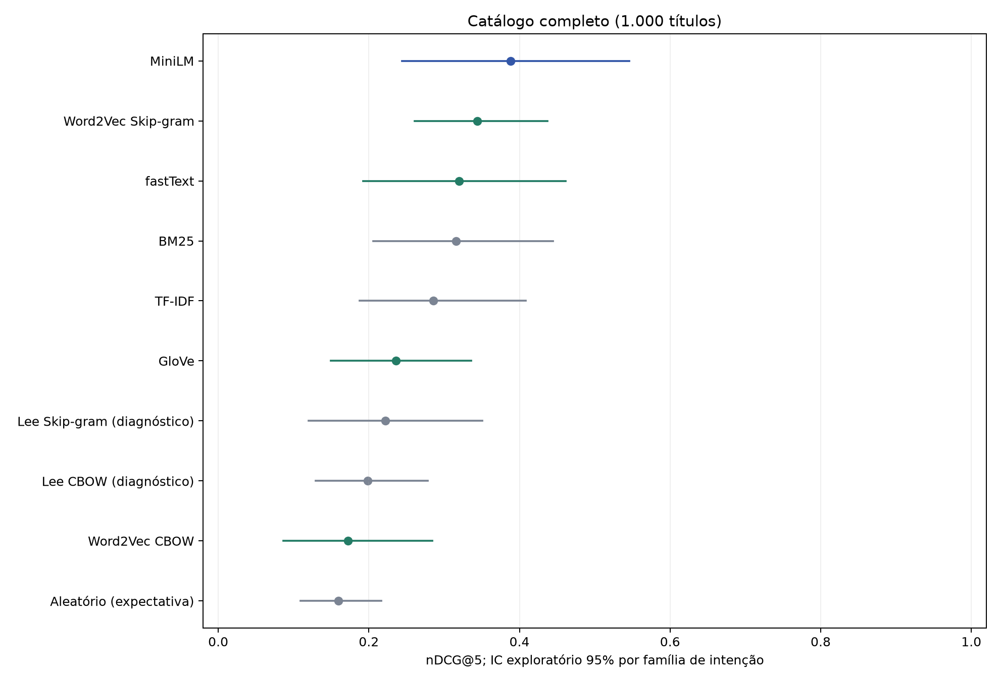
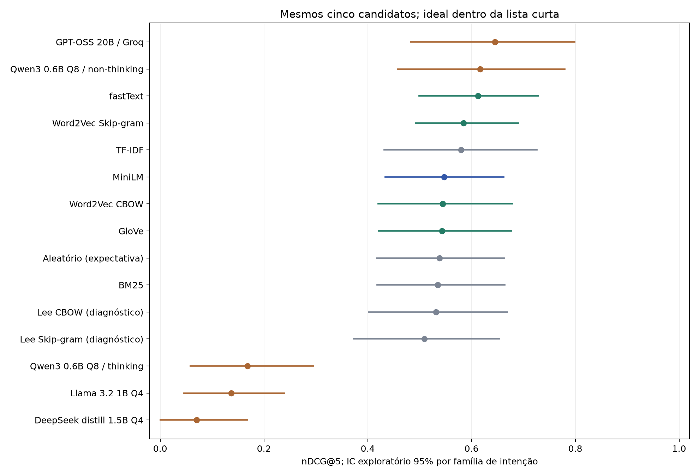

# Comparação de recomendação de anime - inglês

Resultados completos | 1.000 títulos | 24 consultas | relevância por gêneros (proxy)

## Recuperação no catálogo completo

| Pipeline | nDCG@5 | IC 95% | Hit@1 | P@3 | MRR@10 | Recall@10 |
|---|---|---|---|---|---|---|
| MiniLM | 0.389 | 0.244-0.546 | 0.375 | 0.347 | 0.527 | 0.027 |
| Word2Vec Skip-gram | 0.344 | 0.261-0.437 | 0.417 | 0.278 | 0.547 | 0.025 |
| fastText | 0.320 | 0.193-0.461 | 0.375 | 0.278 | 0.478 | 0.028 |
| BM25 | 0.316 | 0.206-0.445 | 0.167 | 0.306 | 0.409 | 0.024 |
| TF-IDF | 0.286 | 0.188-0.409 | 0.292 | 0.278 | 0.466 | 0.022 |
| GloVe | 0.236 | 0.150-0.336 | 0.125 | 0.208 | 0.284 | 0.014 |
| Lee Skip-gram (diagnóstico) | 0.222 | 0.120-0.350 | 0.233 | 0.164 | 0.303 | 0.008 |
| Lee CBOW (diagnóstico) | 0.198 | 0.129-0.278 | 0.150 | 0.192 | 0.352 | 0.015 |
| Word2Vec CBOW | 0.172 | 0.086-0.285 | 0.125 | 0.153 | 0.261 | 0.013 |
| Aleatório (expectativa) | 0.160 | 0.109-0.216 | 0.127 | 0.127 | 0.257 | 0.010 |

## Reordenação dos mesmos cinco candidatos

| Pipeline | nDCG@5 pool | nDCG@5 global | Hit@1 | P@3 | MRR@5 | Inválidas |
|---|---|---|---|---|---|---|
| GPT-OSS 20B / Groq + fallback TF-IDF | 0.672 | 0.319 | 0.500 | 0.306 | 0.552 | 1 |
| GPT-OSS 20B / Groq | 0.645 | 0.310 | 0.500 | 0.292 | 0.531 | 1 |
| Qwen3 0.6B Q8 / non-thinking | 0.617 | 0.304 | 0.417 | 0.264 | 0.500 | 0 |
| Qwen3 0.6B Q8 / non-thinking + fallback TF-IDF | 0.617 | 0.304 | 0.417 | 0.264 | 0.500 | 0 |
| fastText | 0.613 | 0.291 | 0.292 | 0.292 | 0.415 | 0 |
| Qwen3 0.6B Q8 / thinking + fallback TF-IDF | 0.586 | 0.293 | 0.292 | 0.306 | 0.435 | 18 |
| Word2Vec Skip-gram | 0.584 | 0.279 | 0.250 | 0.250 | 0.388 | 0 |
| TF-IDF | 0.580 | 0.286 | 0.292 | 0.278 | 0.431 | 0 |
| DeepSeek distill 1.5B Q4 + fallback TF-IDF | 0.574 | 0.285 | 0.292 | 0.278 | 0.431 | 21 |
| Llama 3.2 1B Q4 + fallback TF-IDF | 0.551 | 0.274 | 0.250 | 0.250 | 0.408 | 15 |
| MiniLM | 0.547 | 0.262 | 0.167 | 0.222 | 0.366 | 0 |
| Word2Vec CBOW | 0.544 | 0.273 | 0.250 | 0.236 | 0.383 | 0 |
| GloVe | 0.543 | 0.270 | 0.250 | 0.236 | 0.360 | 0 |
| Aleatório (expectativa) | 0.539 | 0.264 | 0.225 | 0.225 | 0.364 | 0 |
| BM25 | 0.535 | 0.266 | 0.167 | 0.278 | 0.349 | 0 |
| Lee CBOW (diagnóstico) | 0.532 | 0.266 | 0.208 | 0.250 | 0.355 | 0 |
| Lee Skip-gram (diagnóstico) | 0.509 | 0.261 | 0.208 | 0.208 | 0.333 | 0 |
| Qwen3 0.6B Q8 / thinking | 0.168 | 0.074 | 0.083 | 0.069 | 0.113 | 18 |
| Llama 3.2 1B Q4 | 0.137 | 0.062 | 0.042 | 0.042 | 0.092 | 15 |
| DeepSeek distill 1.5B Q4 | 0.070 | 0.026 | 0.042 | 0.014 | 0.042 | 21 |

## Tempos de consulta e processo

| Escopo / pipeline | Média ms | Mediana ms | p95 ms | Pipeline médio ms | RSS MiB |
|---|---|---|---|---|---|
| Catálogo: MiniLM | 34.779 | 34.386 | 41.529 | 34.779 | 1162.316 |
| Catálogo: Word2Vec Skip-gram | 0.721 | 0.289 | 1.137 | 0.721 | 181.957 |
| Catálogo: fastText | 2.236 | 2.125 | 3.448 | 2.236 | 1065.918 |
| Catálogo: BM25 | 0.263 | 0.251 | 0.444 | 0.263 | 142.766 |
| Catálogo: TF-IDF | 2.511 | 2.293 | 4.126 | 2.511 | 141.355 |
| Catálogo: GloVe | 0.182 | 0.158 | 0.309 | 0.182 | 75.707 |
| Catálogo: Lee Skip-gram (diagnóstico) | 0.284 | 0.185 | 0.377 | 0.284 | 117.094 |
| Catálogo: Lee CBOW (diagnóstico) | 0.261 | 0.178 | 0.481 | 0.261 | 116.648 |
| Catálogo: Word2Vec CBOW | 0.414 | 0.174 | 0.791 | 0.414 | 181.883 |
| Catálogo: Aleatório (expectativa) | 0.005 | 0.002 | 0.007 | 0.005 | 42.047 |
| Lista: GPT-OSS 20B / Groq | 838.279 | 648.925 | 1540.564 | 840.790 | - |
| Lista: Qwen3 0.6B Q8 / non-thinking | 9505.321 | 9764.677 | 11072.083 | 9507.832 | 2466.980 |
| Lista: Qwen3 0.6B Q8 / thinking | 36705.011 | 37491.086 | 42549.255 | 36707.522 | 3586.719 |
| Lista: Llama 3.2 1B Q4 | 13821.571 | 13586.768 | 16434.691 | 13824.082 | 1878.340 |
| Lista: DeepSeek distill 1.5B Q4 | 54301.775 | 54816.767 | 61680.254 | 54304.286 | 2540.934 |

## Cenários de consulta - nDCG@5

| Escopo / pipeline | Literal | Paráfrase | Um gênero | Combinados | Exclusões |
|---|---|---|---|---|---|
| Catálogo: MiniLM | 0.331 | 0.446 | 0.573 | 0.242 | 0.129 |
| Catálogo: Word2Vec Skip-gram | 0.360 | 0.329 | 0.427 | 0.262 | 0.260 |
| Catálogo: fastText | 0.354 | 0.285 | 0.417 | 0.244 | 0.181 |
| Catálogo: BM25 | 0.404 | 0.228 | 0.392 | 0.273 | 0.175 |
| Catálogo: TF-IDF | 0.405 | 0.167 | 0.340 | 0.233 | 0.228 |
| Catálogo: GloVe | 0.175 | 0.297 | 0.270 | 0.175 | 0.254 |
| Catálogo: Lee Skip-gram (diagnóstico) | 0.215 | 0.229 | 0.192 | 0.181 | 0.394 |
| Catálogo: Lee CBOW (diagnóstico) | 0.197 | 0.199 | 0.210 | 0.150 | 0.261 |
| Catálogo: Word2Vec CBOW | 0.156 | 0.189 | 0.218 | 0.153 | 0.075 |
| Catálogo: Aleatório (expectativa) | 0.160 | 0.160 | 0.157 | 0.154 | 0.178 |
| Lista: GPT-OSS 20B / Groq | 0.708 | 0.583 | 0.617 | 0.832 | 0.358 |
| Lista: Qwen3 0.6B Q8 / non-thinking | 0.674 | 0.559 | 0.544 | 0.720 | 0.627 |
| Lista: Qwen3 0.6B Q8 / thinking | 0.233 | 0.103 | 0.167 | 0.206 | 0.097 |
| Lista: Llama 3.2 1B Q4 | 0.053 | 0.221 | 0.182 | 0.089 | 0.097 |
| Lista: DeepSeek distill 1.5B Q4 | 0.083 | 0.057 | 0.000 | 0.210 | 0.000 |

## Diagnósticos das recomendações

| Escopo / pipeline | Cobertura catálogo@5 | Diversidade válida@5 | Falha exclusão@1 | Pool sem ganho |
|---|---|---|---|---|
| Catálogo: MiniLM | 0.068 | 0.850 | 0.500 | 0 |
| Catálogo: Word2Vec Skip-gram | 0.079 | 0.879 | 0.250 | 0 |
| Catálogo: fastText | 0.074 | 0.869 | 0.250 | 0 |
| Catálogo: BM25 | 0.072 | 0.871 | 0.250 | 0 |
| Catálogo: TF-IDF | 0.073 | 0.883 | 0.000 | 0 |
| Catálogo: GloVe | 0.063 | 0.866 | 0.000 | 0 |
| Catálogo: Lee Skip-gram (diagnóstico) | 0.081 | 0.856 | 0.250 | 0 |
| Catálogo: Lee CBOW (diagnóstico) | 0.088 | 0.887 | 0.000 | 0 |
| Catálogo: Word2Vec CBOW | 0.071 | 0.898 | 0.000 | 0 |
| Catálogo: Aleatório (expectativa) | - | - | 0.105 | 0 |
| Lista: GPT-OSS 20B / Groq | 0.072 | 0.881 | 0.250 | 6 |
| Lista: Qwen3 0.6B Q8 / non-thinking | 0.073 | 0.883 | 0.500 | 6 |
| Lista: Qwen3 0.6B Q8 / thinking | 0.029 | 0.855 | 1.000 | 6 |
| Lista: Llama 3.2 1B Q4 | 0.035 | 0.909 | 0.750 | 6 |
| Lista: DeepSeek distill 1.5B Q4 | 0.014 | 0.922 | 1.000 | 6 |

## Diferenças pareadas exploratórias de nDCG@5

| Escopo / diferença | Média | IC 95% inferior | IC 95% superior |
|---|---|---|---|
| Catálogo: BM25 menos Word2Vec CBOW | 0.144 | 0.053 | 0.234 |
| Catálogo: fastText menos Word2Vec CBOW | 0.147 | 0.053 | 0.272 |
| Catálogo: GloVe menos Word2Vec CBOW | 0.064 | -0.004 | 0.126 |
| Catálogo: MiniLM menos Word2Vec CBOW | 0.216 | 0.106 | 0.342 |
| Catálogo: Aleatório (expectativa) menos Word2Vec CBOW | -0.013 | -0.091 | 0.062 |
| Catálogo: TF-IDF menos Word2Vec CBOW | 0.113 | 0.019 | 0.201 |
| Catálogo: Lee CBOW (diagnóstico) menos Word2Vec CBOW | 0.026 | -0.051 | 0.114 |
| Catálogo: Lee Skip-gram (diagnóstico) menos Word2Vec CBOW | 0.050 | -0.025 | 0.142 |
| Catálogo: Word2Vec Skip-gram menos Word2Vec CBOW | 0.172 | 0.098 | 0.254 |
| Lista: BM25 menos TF-IDF | -0.044 | -0.112 | 0.020 |
| Lista: fastText menos TF-IDF | 0.033 | -0.019 | 0.092 |
| Lista: GloVe menos TF-IDF | -0.037 | -0.121 | 0.051 |
| Lista: MiniLM menos TF-IDF | -0.032 | -0.109 | 0.045 |
| Lista: Aleatório (expectativa) menos TF-IDF | -0.041 | -0.094 | 0.011 |
| Lista: Word2Vec CBOW menos TF-IDF | -0.035 | -0.113 | 0.049 |
| Lista: Lee CBOW (diagnóstico) menos TF-IDF | -0.048 | -0.118 | 0.021 |
| Lista: Lee Skip-gram (diagnóstico) menos TF-IDF | -0.071 | -0.148 | 0.006 |
| Lista: Word2Vec Skip-gram menos TF-IDF | 0.005 | -0.079 | 0.094 |
| Lista: DeepSeek distill 1.5B Q4 menos TF-IDF | -0.510 | -0.655 | -0.376 |
| Lista: DeepSeek distill 1.5B Q4 + fallback TF-IDF menos TF-IDF | -0.006 | -0.026 | 0.007 |
| Lista: GPT-OSS 20B / Groq menos TF-IDF | 0.066 | -0.033 | 0.162 |
| Lista: GPT-OSS 20B / Groq + fallback TF-IDF menos TF-IDF | 0.092 | 0.020 | 0.168 |
| Lista: Llama 3.2 1B Q4 menos TF-IDF | -0.443 | -0.555 | -0.339 |
| Lista: Llama 3.2 1B Q4 + fallback TF-IDF menos TF-IDF | -0.029 | -0.070 | 0.009 |
| Lista: Qwen3 0.6B Q8 / thinking menos TF-IDF | -0.412 | -0.593 | -0.238 |
| Lista: Qwen3 0.6B Q8 / thinking + fallback TF-IDF menos TF-IDF | 0.007 | -0.020 | 0.045 |
| Lista: Qwen3 0.6B Q8 / non-thinking menos TF-IDF | 0.037 | -0.045 | 0.117 |
| Lista: Qwen3 0.6B Q8 / non-thinking + fallback TF-IDF menos TF-IDF | 0.037 | -0.045 | 0.117 |

## O que foi comparado e qual é a conclusão provisória

Esta rodada começou depois da conclusão do benchmark de SMS. A tarefa agora é recomendar por busca de conteúdo: ordenar sinopses para pedidos de espectadores. Todas as entradas experimentais e instruções estão em inglês; não houve tradução. Recuperação no catálogo inteiro e reordenação de candidatos são tarefas distintas, apresentadas em tabelas separadas.

O maior nDCG@5 observado na recuperação completa foi de MiniLM: 0.389. Entre os quatro embeddings estáticos principais, o maior valor pontual foi de Word2Vec Skip-gram: 0.344. Esse é o candidato estático para priorizar a próxima etapa de desenvolvimento sob estas condições, não um vencedor científico definitivo. A recomendação deve considerar os intervalos amplos, os cenários de consulta e a origem automática dos julgamentos. O recorte final do TCC continua estático; MiniLM e LLMs são comparadores.

O resultado de SMS não determinava o resultado em anime. Lá uma cabeça supervisionada aprendia spam; aqui os vetores congelados pontuam sem regressão logística, por similaridade entre consulta e sinopse. Descrever essa mudança é essencial para evitar extrapolar um ranking de tarefas diferentes.

## Dataset, parâmetros e referência de relevância

Fonte: Kaggle, Anime Recommendation Database 2020, Hernan Valdivieso, versão 7. Arquivo anime_with_synopsis.csv com 16214 registros. Após filtros de qualidade/idioma e deduplicação, 8409 ficaram elegíveis. Amostra aleatória de 1.000 títulos com seed 20261105; 24 consultas de 12 famílias, com duas formulações cada. Os detalhes e hashes estão em data/freeze.json e data/raw/acquisition.json. O metadado Kaggle declara CC0; a atribuição à fonte MyAnimeList e ao publicador foi preservada.

Cada documento de entrada contém no máximo as primeiras 80 palavras da sinopse inglesa. Esse limite mantém o mesmo conteúdo disponível aos modelos e viabiliza cinco candidatos no contexto local. Removemos marcadores editoriais/fonte, descartamos textos com menos de 40 palavras, gêneros ausentes e duplicatas normalizadas. A detecção de inglês é heurística, não certificação humana; nomes próprios podem conservar sua escrita original. Não fornecemos títulos, gêneros, notas ou popularidade aos modelos.

Os julgamentos usam os gêneros do publicador: 2 satisfaz todos os pedidos sem gênero proibido, 1 satisfaz parte sem proibição, 0 falha ou viola a exclusão. Isso mede aderência a gêneros, não satisfação real, personalização, qualidade do enredo ou julgamento humano independente. Consultas foram preparadas com assistência de IA, antes das respostas. Correlações dentro de cada família e vieses da taxonomia limitam generalização.

As famílias são esportes, mecha, mistério, romance, comédia, ficção científica, ação+aventura, fantasia+romance, escola+comédia, sobrenatural+mistério, ação sem mecha e romance sem escola. Cada uma tem formulação literal e paráfrase em inglês. Nenhum parâmetro foi selecionado por melhorar essas consultas.

## Modelos e formas de operação

GloVe usa text8, 50 dimensões; fastText usa fil9, 100 dimensões; Word2Vec CBOW/Skip-gram usam text8, 100 dimensões. São os pesos anteriormente instalados, sem novo treinamento. A representação do texto é média dos vetores ponderada por IDF do catálogo, seguida de L2. Tokenização: NFKC, casefold, sequências Unicode de letras; sem stopwords, stemming ou tradução. GloVe/Word2Vec descartam OOV; fastText compõe subpalavras via CLI persistente. Consultas individuais não reutilizam um embedding de consulta pré-calculado.

TF-IDF usa unigramas/bigramas, TF sublinear, IDF do catálogo e L2. BM25 usa k1=1,2 e b=0,75, com IDF positivo log(1+(N-df+0,5)/(df+0,5)), somando termos distintos da consulta. São baselines lexicais, não embeddings neurais estáticos. A construção de IDF no catálogo usa texto sem rótulos, como índice de busca. MiniLM é sentence-transformers/paraphrase-multilingual-MiniLM-L12-v2, 384 dimensões, revisão previamente fixada, CPU quatro threads, batch 32 na indexação e limite original 128 tokens. Truncamentos ficam registrados nos metadados.

Os geradores são Llama 3.2 1B Instruct Q4_K_M, DeepSeek-R1-Distill-Qwen 1.5B Q4_K_M, Qwen3 0.6B Q8_0 e GPT-OSS 20B pela Groq Free. A proveniência exata, tamanhos e licenças constam no manifesto da instalação SMS; as conversões Llama/DeepSeek são comunitárias Bartowski, e o GGUF Qwen é oficial. O runtime local é llama.cpp b12110 em CPU, quatro threads, contexto 2.048 e uma requisição por vez. Servidores restritos a 127.0.0.1.

Saída máxima 512 tokens, incluindo raciocínio. Llama: raciocínio off, temperatura 0,6/top_p 0,95. DeepSeek: on, 0,6/0,95. Qwen thinking: on, 0,6/0,95/top_k20/min_p0/presença1,5. Qwen non-thinking: off, 0,7/0,8/top_k20/min_p0/presença1,5, variante explicitamente separada. GPT-OSS: reasoning_effort low, 0,6/0,95. Seed por consulta: 20261105+índice. Estes orçamentos são restrições do experimento local; não reproduzem os orçamentos extensos recomendados para benchmarks complexos dos fabricantes. Uma falha com 512 tokens não mede a capacidade máxima da família.

## Por que separar recuperação de reordenação

Na recuperação completa, cada encoder ou baseline recebe uma consulta e pontua 1.000 documentos. Na reordenação, todos recebem os mesmos cinco documentos pré-selecionados por TF-IDF, congelados sem olhar a relevância. A ordem de apresentação é permutada com seed por consulta e os itens são chamados A-E. LLMs não podem escolher fora dessa lista. Os encoders também são avaliados nessa lista comum.

O nDCG principal do reranking é normalizado pelo ideal dentro dos cinco. Um nDCG alto nesse quadro não significa que o pipeline encontrou os melhores títulos do catálogo. O JSON preserva também a normalização global, a quantidade de itens estritamente relevantes no pool e os pools sem ganho positivo. Recall do conjunto de cinco não melhora só por trocar a ordem.

Uma resposta válida é uma lista JSON com A-E exatamente uma vez cada. Inválidas recebem qualidade zero no resultado bruto. A variante com fallback recorre à ordem TF-IDF e mantém o contador de falhas; seu ganho não é creditado como acerto do LLM. Não usamos um LLM para julgar os LLMs. Aderência às exclusões é avaliada pelos metadados da fonte, e inválida conta como falha conservadora nas consultas de exclusão.

Empates de scores recebem qualidade esperada sob permutações uniformes. O código foi verificado por enumeração de pequenas permutações e pelo scikit-learn com ganhos exponenciais explícitos. Exemplos exibidos e diagnósticos de diversidade/cobertura usam ID fixo no desempate, o que é diferente de atribuir crédito arbitrário às métricas principais.

## Leitura por pipeline

MiniLM: nDCG@5 0.389, Hit@1 0.375, P@3 0.347, latência média 34.779 ms. Cobertura lexical/truncamentos/preparação, quando aplicáveis: {"query_vocabulary_coverage": null, "truncation": {"limit": 128, "documents_over_limit": 100, "max_document_tokens": 164}, "preparation_seconds": 99.32636503999998}.

Word2Vec Skip-gram: nDCG@5 0.344, Hit@1 0.417, P@3 0.278, latência média 0.721 ms. Cobertura lexical/truncamentos/preparação, quando aplicáveis: {"query_vocabulary_coverage": 1.0, "truncation": null, "preparation_seconds": 3.407364053000002}.

fastText: nDCG@5 0.320, Hit@1 0.375, P@3 0.278, latência média 2.236 ms. Cobertura lexical/truncamentos/preparação, quando aplicáveis: {"query_vocabulary_coverage": null, "truncation": null, "preparation_seconds": 6.139285207}.

BM25: nDCG@5 0.316, Hit@1 0.167, P@3 0.306, latência média 0.263 ms. Cobertura lexical/truncamentos/preparação, quando aplicáveis: {"query_vocabulary_coverage": null, "truncation": null, "preparation_seconds": 3.1932369000000005}.

TF-IDF: nDCG@5 0.286, Hit@1 0.292, P@3 0.278, latência média 2.511 ms. Cobertura lexical/truncamentos/preparação, quando aplicáveis: {"query_vocabulary_coverage": null, "truncation": null, "preparation_seconds": 3.544579800000001}.

GloVe: nDCG@5 0.236, Hit@1 0.125, P@3 0.208, latência média 0.182 ms. Cobertura lexical/truncamentos/preparação, quando aplicáveis: {"query_vocabulary_coverage": 1.0, "truncation": null, "preparation_seconds": 2.4153294999999986}.

Lee Skip-gram (diagnóstico): nDCG@5 0.222, Hit@1 0.233, P@3 0.164, latência média 0.284 ms. Cobertura lexical/truncamentos/preparação, quando aplicáveis: {"query_vocabulary_coverage": 0.39705882352941174, "truncation": null, "preparation_seconds": 2.047875916999999}.

Lee CBOW (diagnóstico): nDCG@5 0.198, Hit@1 0.150, P@3 0.192, latência média 0.261 ms. Cobertura lexical/truncamentos/preparação, quando aplicáveis: {"query_vocabulary_coverage": 0.39705882352941174, "truncation": null, "preparation_seconds": 2.155218974999997}.

Word2Vec CBOW: nDCG@5 0.172, Hit@1 0.125, P@3 0.153, latência média 0.414 ms. Cobertura lexical/truncamentos/preparação, quando aplicáveis: {"query_vocabulary_coverage": 1.0, "truncation": null, "preparation_seconds": 4.192366918000001}.

Aleatório (expectativa): nDCG@5 0.160, Hit@1 0.127, P@3 0.127, latência média 0.005 ms. Cobertura lexical/truncamentos/preparação, quando aplicáveis: {"query_vocabulary_coverage": null, "truncation": null, "preparation_seconds": 0.04734209999999983}.

GPT-OSS 20B / Groq na lista comum: nDCG@5 0.645; inválidas 1/24; encerramentos por limite 0; resposta média 838.279 ms; pipeline estimado médio 840.790 ms. Diferenças de rede/hardware e orçamento devem acompanhar qualquer comparação de tempo.

Qwen3 0.6B Q8 / non-thinking na lista comum: nDCG@5 0.617; inválidas 0/24; encerramentos por limite 0; resposta média 9505.321 ms; pipeline estimado médio 9507.832 ms. Diferenças de rede/hardware e orçamento devem acompanhar qualquer comparação de tempo.

Qwen3 0.6B Q8 / thinking na lista comum: nDCG@5 0.168; inválidas 18/24; encerramentos por limite 15; resposta média 36705.011 ms; pipeline estimado médio 36707.522 ms. Diferenças de rede/hardware e orçamento devem acompanhar qualquer comparação de tempo.

Llama 3.2 1B Q4 na lista comum: nDCG@5 0.137; inválidas 15/24; encerramentos por limite 0; resposta média 13821.571 ms; pipeline estimado médio 13824.082 ms. Diferenças de rede/hardware e orçamento devem acompanhar qualquer comparação de tempo.

DeepSeek distill 1.5B Q4 na lista comum: nDCG@5 0.070; inválidas 21/24; encerramentos por limite 14; resposta média 54301.775 ms; pipeline estimado médio 54304.286 ms. Diferenças de rede/hardware e orçamento devem acompanhar qualquer comparação de tempo.

## Exemplos reais para inspecionar

Consulta inglesa: I want athletes working hard to improve and compete.

Word2Vec Skip-gram [full_retrieval]: Yoshimune (MAL 2024; grau 0; gêneros: Comedy, Historical); Nintama Rantarou Movie (MAL 2710; grau 0; gêneros: Comedy, Shounen); Denki-gai no Honya-san (MAL 24031; grau 0; gêneros: Comedy, Seinen, Slice of Life)

MiniLM [full_retrieval]: Haikyuu!! Second Season (MAL 28891; grau 2; gêneros: Comedy, Drama, School, Shounen, Sports); Inazuma Eleven Go: Galaxy (MAL 18097; grau 2; gêneros: Shounen, Sports, Super Power); Yowamushi Pedal Movie (MAL 30413; grau 2; gêneros: Comedy, Drama, Shounen, Sports)

GPT-OSS 20B / Groq [shared_pool]: Higuma no Ongaeshi (MAL 39427; grau 0; gêneros: Kids); Aquarion Movie: Ippatsu Gyakuten-hen (MAL 6032; grau 0; gêneros: Drama, Fantasy, Mecha); Kaitou Joker 3rd Season (MAL 31670; grau 0; gêneros: Adventure, Comedy, Mystery, Shounen)

Consulta inglesa: I want a love story in an imaginative world with fantastic elements.

Word2Vec Skip-gram [full_retrieval]: KiyaKiya (MAL 34286; grau 0; gêneros: Music, Psychological); Yoroiden Samurai Troopers Message (MAL 1267; grau 1; gêneros: Adventure, Fantasy, Samurai, Shounen); Genki Genki Non-tan (MAL 25609; grau 0; gêneros: Kids, Music)

MiniLM [full_retrieval]: Ayakashi: Japanese Classic Horror (MAL 586; grau 1; gêneros: Fantasy, Historical, Horror, Mystery); Crayon Shin-chan Movie 04: Henderland no Daibouken (MAL 8359; grau 0; gêneros: Adventure, Ecchi, Magic, Seinen); Eternity: Shinya no Nurekoi Channel ♡ (MAL 42414; grau 1; gêneros: Ecchi, Romance)

GPT-OSS 20B / Groq [shared_pool]: Otogi Juushi Akazukin OVA (MAL 402; grau 1; gêneros: Adventure, Comedy, Fantasy, Magic); Ano Ko ni 1000% (MAL 7475; grau 1; gêneros: Romance, School, Shoujo); Kawaikereba Hentai demo Suki ni Natte Kuremasu ka? (MAL 39326; grau 1; gêneros: Comedy, Ecchi, Harem, Romance, School)

Consulta inglesa: Recommend an action anime, but exclude mecha and giant robots.

Word2Vec Skip-gram [full_retrieval]: Youkai Ningen Bem (MAL 4044; grau 0; gêneros: Demons, Horror); Radiant (MAL 37202; grau 2; gêneros: Action, Adventure, Fantasy, Magic); Keishichou Tokumubu Tokushu Kyouakuhan Taisakushitsu Dainanaka: Tokunana (MAL 39567; grau 2; gêneros: Action, Fantasy, Police, Vampire)

MiniLM [full_retrieval]: Crayon Shin-chan Movie 04: Henderland no Daibouken (MAL 8359; grau 0; gêneros: Adventure, Ecchi, Magic, Seinen); Elite Jack!! (MAL 24985; grau 0; gêneros: School, Shoujo); Maken Liner 0011 Henshin Seyo! (MAL 11269; grau 0; gêneros: Action, Mecha, Sci-Fi)

GPT-OSS 20B / Groq [shared_pool]: Dragon Ball Z: The Real 4-D (MAL 33947; grau 2; gêneros: Action, Fantasy, Shounen, Super Power); Ar:pieL - 6-seosgae-ui Unmyeong (MAL 34779; grau 2; gêneros: Action, Fantasy); Zen-chan Two-chan (MAL 39450; grau 0; gêneros: Kids)

Consulta inglesa: I want a love story that is not about students at school.

Word2Vec Skip-gram [full_retrieval]: Massugu ni Ikou. (MAL 1617; grau 2; gêneros: Comedy, Josei, Romance, Slice of Life); Kimi no Iru Machi: Tasogare Kousaten (MAL 11313; grau 0; gêneros: Drama, Romance, School, Shounen); Pokemon Movie 20: Kimi ni Kimeta! (MAL 34540; grau 0; gêneros: Action, Adventure, Comedy, Kids)

MiniLM [full_retrieval]: Yagami-kun no Katei no Jijou (MAL 4537; grau 0; gêneros: Comedy); Ayakashi: Japanese Classic Horror (MAL 586; grau 0; gêneros: Fantasy, Historical, Horror, Mystery); Nagareboshi Lens (MAL 13833; grau 2; gêneros: Romance, Shoujo)

GPT-OSS 20B / Groq [shared_pool]: Mianhada Saranghanda (MAL 9254; grau 0; gêneros: Drama); Thermae Romae Specials (MAL 12727; grau 0; gêneros: Comedy, Historical, Seinen); Shugo Chara! Party! (MAL 7082; grau 0; gêneros: Comedy, Magic, School, Shoujo)

## Como interpretar tempo, custo e próxima decisão

A comparação mede o tempo até a resposta completa, não tempo até primeiro token. Indexação/carga é separada e pode ser amortizada. A tabela dos LLMs mostra a latência do reranker e a estimativa composta de TF-IDF+reranker. O tempo do encoder em lista curta reutiliza a medição real de codificação+busca no catálogo inteiro; não foi inventada uma medição exclusiva de cinco scores. Pausas Groq são excluídas da latência individual e incluídas no total da etapa. Hardware e memória do servidor remoto são desconhecidos. RSS local é pico de processo, não soma da máquina; tamanho no disco é outra medida.

Os modelos estáticos continuam elegíveis para o TCC por escopo, simplicidade e implantação local, mas não precisamos ocultar resultados melhores de um comparador. Um encoder de sentença pode ser mais adequado a paráfrases; um baseline lexical pode funcionar bem quando os termos coincidem. LLMs podem ser úteis para reordenar pedidos compostos, mas só vale adicioná-los se o ganho observado justificar latência, falhas e complexidade. Sem ganho confiável, a arquitetura mais simples é uma escolha defensável.

Para exclusões conhecidas, uma interface com filtros estruturados de gênero pode resolver a restrição de forma mais previsível que pedir a uma média de vetores que entenda negação. Este benchmark não conta um filtro com acesso aos próprios rótulos como vitória semântica. Em produção, avaliar separadamente filtros explícitos e ranking textual.

O próximo estudo científico deve ampliar consultas reais, validar relevância com avaliadores humanos cegos, separar desenvolvimento/teste, repetir sementes e controlar corpora/orçamentos quando a pergunta for comparar algoritmos. Inglês-inglês nesta rodada não demonstra desempenho português-inglês. Não inferimos personalização de um teste sem histórico de usuários. Catálogo público e antigo também pode ter sido visto por modelos no pré-treinamento.

## Decisão de engenharia e por que não priorizar os outros agora

Para começar o protótipo de recuperação, priorizamos provisoriamente Word2Vec Skip-gram: maior nDCG@5 entre os estáticos no catálogo completo (0.344), Hit@1 0.417, média 0.721 ms e pico observado de aproximadamente 182.0 MiB. São vetores já preparados; o programa não precisará treinar esse modelo. Esta é uma decisão inicial de engenharia sob rótulos de gêneros, não uma seleção científica definitiva para preferências reais.

O CBOW, que parecia promissor no complemento de SMS, teve nDCG@5 0.172 em anime. O baseline sem informação ficou em 0.160. Portanto o resultado de classificação não sustenta priorizar CBOW nesta tarefa de recuperação. Não afirmar que a família CBOW é incapaz: o corpus, os vetores e a agregação desta instalação são específicos.

GloVe é compacto e muito rápido, mas seu nDCG@5 de 0.236 não liderou a recuperação de anime. O fastText ficou em 0.320 no catálogo completo e 0.613 na lista curta, com composição de OOV, mas consumiu aproximadamente 1065.9 MiB. É o concorrente estático mais importante para continuar investigando; o Skip-gram é um ponto inicial mais compacto nesta instalação. O teste Rare Words já havia sido concluído em 29/10: 2.034 pares, zero descartados, Spearman rho 0,4177019229655776, usando avaliador oficial e espelho AWS corroborado. Isso é correlação de similaridade, não acurácia ou nDCG de recomendação. A proveniência e seus limites estão em laboratorio/docs/07-rare-words-resolucao.md; não houve novo teste RW nesta rodada.

BM25 (0.316) e TF-IDF (0.286) devem permanecer como referências de RI. BM25 ficou próximo de fastText nessa medida, com menor custo observado. Não é correto esconder esses baselines para favorecer embeddings. Uma solução híbrida determinística pode ser avaliada posteriormente, em dados de desenvolvimento separados, sem treinar modelos.

MiniLM teve o melhor valor pontual no catálogo completo (0.389), mas é contextual e está fora do recorte final confirmado pelo usuário. Ele não foi excluído por ser ruim ou inviável: funciona e serve como referência de qualidade. Os intervalos são amplos; não declaramos diferença garantida para todas as novas consultas.

Na mesma lista de cinco, fastText ficou em 0.613, Qwen sem raciocínio em 0.617 e GPT-OSS em 0.645. Isso sustenta investigar se um pipeline estático simples entrega qualidade competitiva sob essas condições. Não comprova equivalência. Há diferenças em outras métricas: Hit@1 foi 0.292, 0.417 e 0.500, respectivamente. O LLM pode melhorar a primeira sugestão mesmo quando o nDCG médio fica próximo. Também não comparar o nDCG da lista curta com o do catálogo completo como se tivessem o mesmo ideal.

Qwen sem raciocínio completou todas as permutações válidas, enquanto Qwen thinking, Llama e DeepSeek tiveram, respectivamente, 18, 15 e 21 saídas inválidas de 24. A condição sem raciocínio usou também temperatura/top_p diferentes, conforme os modos recomendados; não é uma ablação que modifica somente o raciocínio. As falhas medem este pipeline de saída livre e seu orçamento. Não provam incapacidade semântica da família: gramática/JSON schema e outro orçamento seriam variantes futuras, com protocolo próprio. Os fallbacks foram identificados separadamente e não contam como raciocínio correto do LLM.

GPT-OSS depende da Groq, cota e rede; o hardware remoto é desconhecido. Os geradores locais consomem segundos por consulta e não são elegíveis no programa final definido pelo usuário. Não há motivo para introduzi-los agora num sistema de RI que deve usar vetores estáticos. Isso é uma escolha de escopo e custo operacional, sem alegação de que modelos modernos são sempre inferiores.

O diagnóstico atual não valida as duas modalidades do produto: anime-para-anime sem perfil e anime-para-anime ponderado por preferências. Não avaliamos aqui o histórico pessoal do usuário nem garantimos a presença de títulos recentes como Lycoris Recoil nesta base de 2020. A próxima fase deve usar dados adequados, tags específicas como Yuri e Cute Girls Doing Cute Things, e avaliação da preservação da âncora junto à mudança de preferência. As regras de personalização serão aritméticas e explícitas, sem treinamento ou ajuste dos embeddings.

## Limite de recuperação da lista curta

Mesmo uma ordenação perfeita dos cinco candidatos TF-IDF teria nDCG@5 global médio de 0.348. Esse é o limite de recuperação dessa lista, não a qualidade medida de um modelo. Assim, o nDCG normalizado dentro do pool pode ser alto e ainda haver títulos melhores fora dele. Precisamos avaliar a recuperação de candidatos antes de atribuir toda a qualidade ao reranker. Intervalos de diferenças na tabela são exploratórios, pareados por família, e não estabelecem equivalência nem corrigem toda a seleção entre múltiplos sistemas.

## Guia completo de métricas, fórmulas e utilidade

# Métricas explicadas para leitura do comparativo

Este guia distingue classificação de SMS e busca/recomendação de anime. As fórmulas não tornam um julgamento de relevância automaticamente correto: qualidade dos rótulos, amostra e cenário continuam essenciais. Nenhuma métrica isolada escolhe o modelo final do TCC.

## 1. A matriz de confusão dos SMS

Chamamos spam de classe positiva e ham (mensagem legítima) de negativa.

- TP: spam identificado corretamente.
- FP: mensagem legítima acusada de spam. Pode bloquear uma conversa importante.
- FN: spam que não foi identificado. Pode deixar uma fraude passar.
- TN: mensagem legítima identificada corretamente.

Um LLM também pode não fornecer um rótulo utilizável. Guardamos a matriz com duas linhas de verdade (ham/spam) e três colunas de predição (ham/spam/inválida). Uma inválida nunca vira acerto e não é descartada. Para recall/F1 de uma classe, a inválida daquela classe conta como exemplo não recuperado. Para acurácia, é um erro. Isso evita favorecer um sistema por avaliar apenas suas respostas fáceis.

## 2. Acurácia, precisão, recall e F1

Acurácia = quantidade de rótulos corretos / quantidade total de mensagens, incluindo inválidas no denominador. Mede o acerto global. Com 175 ham e 25 spam, responder sempre ham dá 175/200 = 87,5%. Portanto esse número sozinho pode esconder a ausência de detecção de spam.

Precisão de spam = TP/(TP+FP). Pergunta: entre as mensagens que o sistema acusou de spam, quantas realmente eram spam? Útil quando um falso bloqueio é caro. Exemplo ilustrativo: 20 spams encontrados e cinco mensagens legítimas acusadas dão 20/25 = 80% de precisão. Sem predições de spam, registramos precisão zero, não omitimos o sistema.

Recall de spam = TP/(TP+FN), contando também spams com saída inválida entre os não encontrados. Pergunta: de todos os spams existentes, quantos encontramos? Útil quando deixar uma fraude passar é caro. Se existiam 25 spams e encontramos 20, recall = 80%.

F1 de spam = 2*precisão*recall/(precisão+recall) = 2TP/(2TP+FP+FN). É a média harmônica: penaliza um desempenho muito baixo em uma das duas dimensões. Nesta fórmula FN inclui spams inválidos. É a métrica principal dos SMS, mas não distingue sozinha se os erros foram falsos bloqueios ou spams perdidos. Registramos zero se o denominador é zero.

Macro-F1 = (F1_ham + F1_spam)/2. Dá o mesmo peso às duas classes, apesar do número diferente de mensagens. Não confundir com calcular F1 usando as médias de precisão e recall. Balanced accuracy = (recall_ham + recall_spam)/2. Também dá peso igual às classes, mas considera recall, não precisão.

## 3. Probabilidades, ROC-AUC, AP e Brier

Uma regressão logística fornece um score probabilístico de spam. O limiar fixado nesta rodada é 0,5. Um gerador que respondeu apenas ham/spam não forneceu essa distribuição de scores; não inventamos probabilidades para ele. Similaridade de vetores tampouco é probabilidade de um usuário gostar de um anime.

ROC-AUC: probabilidade de um spam escolhido aleatoriamente receber score maior que um ham escolhido aleatoriamente; um empate contribui metade. Equivale à área sob a curva de taxa de positivos verdadeiros versus taxa de falsos positivos quando variamos o limiar. Quanto maior, melhor; 0,5 corresponde ao comportamento sem discriminação nessa interpretação. Avalia ordenação, não o acerto com limiar 0,5, e pode esconder dificuldades práticas com a classe rara.

Average precision (AP) = soma, ao longo dos limiares, de (recall_n - recall_anterior)*precisão_n. Resume a recuperação de positivos com seus scores e é útil para classes raras. Maior é melhor. AP não é idêntica à integração trapezoidal da curva precisão-recall. Reportamos o nome exato para permitir reprodução.

Brier = média de (p_spam - y)^2, com y=1 para spam e 0 para ham. Menor é melhor; zero significa probabilidades exatamente corretas nos exemplos observados. Uma previsão p=0,9 para uma mensagem legítima produz erro quadrático 0,81, muito maior que p=0,1 (0,01). Mede qualidade probabilística, combinando discriminação e calibração. Não mede somente calibração. A cabeça usa class_weight=balanced: seu score não deve ser tratado como frequência real calibrada sem avaliação adicional.

## 4. Custos operacionais hipotéticos

No cenário de custos iguais: FP + FN + inválidas. Para proteger mensagens legítimas: 5*FP + FN + 5*inválidas. Para priorizar detecção de spam: FP + 5*FN + 5*inválidas. Aqui FN designa a predição ham para um spam; inválidas são cobradas separadamente uma única vez. Uma inválida recebe conservadoramente o maior peso de erro do cenário.

Menor custo é melhor sob aquelas suposições. As unidades não são reais, dinheiro ou custos medidos com usuários. Mudamos apenas a interpretação dos erros existentes, não o limiar ou as predições. São análises exploratórias pós-hoc, úteis para discutir requisitos. Não podemos escolher depois o custo que faz nosso modelo favorito vencer e tratá-lo como hipótese prévia confirmada.

## 5. Relevância dos animes e limites do teste

O catálogo contém 1.000 sinopses. Cada consulta tem preferências de gêneros e, às vezes, uma exclusão. A referência automática usa os gêneros do publicador: grau 2 satisfaz todos os gêneros pedidos e nenhuma exclusão; grau 1 satisfaz parte dos pedidos sem violar exclusão; grau 0 não satisfaz ou viola uma exclusão. Os gêneros não entram nos textos dos modelos; servem para avaliar.

Esses rótulos são uma aproximação controlada de aderência a gêneros, não avaliações humanas de gosto, enredo ou qualidade. Uma taxonomia incompleta pode penalizar uma recomendação plausível. As consultas foram preparadas com assistência de IA antes dos rankings; não representam uma amostra independente de usuários. Esta fase ajuda a testar o sistema; o trabalho acadêmico final precisará de julgamentos humanos e/ou dados de preferência adequados à pergunta científica.

## 6. nDCG@5: qualidade da ordem dos primeiros resultados

Para uma lista de até cinco itens, DCG@5 = soma de (2^grau_i - 1)/log2(i+1), com a posição i começando em 1. Os ganhos dos graus 0, 1 e 2 são 0, 1 e 3. A divisão por log2(i+1) reduz a contribuição de resultados mais distantes do topo. nDCG@5 = DCG@5 / IDCG@5, onde IDCG é o DCG da melhor ordenação possível na coleção de referência. Maior é melhor; 1 representa uma ordenação ideal segundo esses rótulos. Se o ideal tem ganho zero, registramos zero e contamos esse caso.

Exemplo meramente didático de três itens: graus [2,1,0] produzem DCG = 3 + 1/log2(3), aproximadamente 3,631. A ordem [1,2,0] produz 1 + 3/log2(3), aproximadamente 2,893; nDCG aproximadamente 0,797 quando [2,1,0] é o ideal. Há itens relevantes nas duas listas, mas a melhor recomendação apareceu mais cedo na primeira.

Na recuperação completa, o ideal considera o catálogo inteiro. Na reordenação de cinco candidatos, a métrica principal usa o ideal dentro desses mesmos cinco, para isolar a ordenação. Também guardamos nDCG em relação ao ideal global. Não misturamos essas normalizações numa única tabela: um reranker pode ordenar perfeitamente uma lista que deixou bons títulos fora.

## 7. Hit@1, Precision@3, Recall@10 e MRR

Hit@1 = média, entre consultas, de 1 se o primeiro item é grau 2 e 0 caso contrário. Mede a chance de a primeira sugestão atender completamente ao pedido segundo a referência. Uma sugestão parcialmente relevante não conta como hit, embora receba ganho no nDCG.

Precision@3 = quantidade de itens grau 2 nas três primeiras posições / 3, depois média entre consultas. Mede a concentração de boas sugestões no começo da lista. É precisão de ranking, diferente da precisão do classificador de spam.

Recall@10 = quantidade de itens grau 2 recuperados nos dez primeiros / quantidade de itens grau 2 existentes no catálogo, depois média entre consultas. É útil para medir quantos candidatos relevantes a recuperação consegue alcançar. Em um gênero amplo com centenas de títulos relevantes, recall@10 será baixo mesmo com dez boas sugestões. Por isso deve ser lido junto com Precision e nDCG, não como uma nota isolada de satisfação.

MRR@k = média de 1/r, onde r é a posição do primeiro item grau 2 dentro dos k primeiros. Se não houver, vale zero. Se a primeira boa sugestão está em primeiro lugar, contribui 1; em segundo, 0,5; em quinto, 0,2. Usamos MRR@10 na recuperação completa e MRR@5 na lista curta. Mede rapidez para encontrar a primeira boa opção, mas não avalia a qualidade dos demais itens da lista.

## 8. Limite da lista de candidatos e falhas

Todos os rerankers recebem os mesmos cinco candidatos selecionados por TF-IDF, em uma ordem de entrada permutada previamente. Eles não podem devolver um anime que não entrou nessa lista. O recall do conjunto de cinco é invariável sob uma permutação válida: a reordenação melhora posições, não recupera itens novos. Reportamos o limite de qualidade atingível e a quantidade de listas sem ganho positivo.

Uma permutação válida contém exatamente A, B, C, D e E uma vez cada. Saída incompleta, repetida, inexistente ou explicação sem JSON válido é inválida. O resultado bruto recebe qualidade zero; não escolhemos trechos favoráveis do raciocínio. Um pipeline adicional, identificado como fallback, usa a ordem TF-IDF nesses casos e informa quantas vezes precisou fazer isso. Seu resultado não é apresentado como acerto do LLM.

Nas consultas com exclusão, verificamos se o primeiro item tem um gênero proibido nos metadados. Uma saída inválida não constitui recomendação segura: a taxa conservadora de falha de restrição conta também essas inválidas. Essa medida só é interpretável no subconjunto com restrições, e o número de casos é pequeno. Taxa de respostas válidas = saídas no formato solicitado / consultas; mais alta é melhor para integração. Encerramento por limite de tokens é diagnóstico: pode explicar uma resposta incompleta, mas não a transforma em acerto.

## 9. Cobertura e diversidade: diagnósticos de recomendação

Cobertura do catálogo@5 = quantidade de títulos diferentes recomendados entre os cinco primeiros de todas as consultas / tamanho do catálogo. Mostra se as listas ficam concentradas em poucos títulos. Não prova que os títulos adicionais são bons. Aqui existem apenas 24 consultas e 1.000 títulos: o máximo observável seria 120 títulos diferentes, isto é, 12% de cobertura. As consultas correlacionadas também reduzem esse valor. Não comparar com outro estudo que usa número diferente de consultas sem considerar esse limite.

Diversidade de gêneros@5: para cada par de itens da lista, calcular distância Jaccard = 1 - |gêneros_A interseção gêneros_B|/|gêneros_A união gêneros_B|; tirar a média dos pares e depois das listas válidas. Mais alto indica listas com gêneros mais diferentes. Isso não é automaticamente melhor: um pedido específico pode desejar sugestões semelhantes. Só usamos metadados após o ranking para descrever o resultado. Listas inválidas não recebem diversidade inventada; sua taxa de falhas aparece separadamente.

Nos diagnósticos de listas exibidas, empates usam ID fixo, enquanto métricas principais calculam a expectativa sob permutações uniformes dos empatados. Isso evita favorecer a qualidade de um modelo sem informação. O baseline aleatório representa essa expectativa de scores empatados; não atribuímos a ele uma cobertura arbitrária de IDs.

## 10. Tempo, memória e armazenamento

Preparação/indexação: carregar pesos, construir o índice e codificar o catálogo; ocorre antes das consultas. Seu custo pode ser amortizado por muitas recomendações. No SMS também há codificação do treino e ajuste da cabeça logística, registrados separadamente do treinamento histórico dos embeddings.

Latência por consulta: tempo observado para gerar a decisão/resposta completa. Nos encoders, inclui transformar a consulta em vetor e calcular os scores. Nos geradores, inclui processamento do prompt, raciocínio e resposta final. Média = soma dos tempos/N; mediana é o valor central; p95 é o percentil amostral de 95%, calculado com interpolação do NumPy. P95 é útil para observar a cauda de respostas demoradas, mas não é uma garantia de SLA e é instável com só 24 consultas.

No pipeline com reranker, tempo operacional estimado por consulta = recuperação TF-IDF medida + resposta do reranker medida. É uma composição de medições, não teste de serviço concorrente em produção. Os retrievers no catálogo completo têm o tempo real de sua busca completa; não fingimos que medimos separadamente somente cinco scores. Não inferimos TTFT (tempo até primeiro token) da latência total: sem streaming instrumentado, TTFT não foi medido.

Throughput serial = 1/latência média em segundos, quando aplicável. Não é vazão de múltiplos usuários em paralelo. Groq inclui rede e serviço em hardware remoto desconhecido. Pausas preventivas por cota aparecem no tempo total da etapa, mas não na latência individual de resposta. Esperas de retry são preservadas. Diferenças de hardware impedem atribuir tudo ao modelo.

RSS é memória residente de processo. KiB/1.024 dá MiB. GNU time registra o maior processo da execução; isso captura o CLI fastText, mas não soma toda a máquina. Para geradores locais lemos o pico do servidor e registramos o cliente separadamente. A RAM remota Groq é desconhecida, não zero. Tamanho de arquivo no disco é outro conceito e não substitui RSS. Gratuidade de API não significa ausência de consumo elétrico ou de recursos locais; energia não foi medida nesta rodada.

## 11. Cobertura lexical, truncamento e incerteza

Cobertura lexical = tokens com entrada exata no vocabulário / tokens consultados. GloVe/Word2Vec sem entrada descartam a palavra; fastText pode compor uma representação por subpalavras. Ter vetor para um termo raro não prova que seu significado foi aprendido. Consulta com scores todos zero é um diagnóstico de ausência de discriminação, não prova isolada de qual componente falhou.

Truncamento: quantidade de textos que ultrapassam o limite de tokens do encoder. Todos os modelos recebem o mesmo trecho de até 80 palavras, mas tokenizadores diferentes geram números diferentes de tokens. MiniLM conserva limite 128 e os excessos são contados. Nos LLMs verificamos os prompts renderizados e reservamos 512 tokens de saída dentro do contexto 2.048 antes de prever, sem cortar candidatos de modo desigual.

Intervalos de 95% por bootstrap são obtidos reamostrando os exemplos/unidades e recalculando a métrica 5.000 vezes, com seed 20261105; usamos os percentis 2,5 e 97,5. Nos SMS preservamos 175 ham e 25 spam. Em anime reamostramos as 12 famílias de intenção, mantendo juntas formulação literal e paráfrase. Reutilizamos as mesmas amostras entre modelos para diferenças pareadas.

Esses intervalos descrevem incerteza condicional à amostra e aos modelos fixos. Não incluem erro dos rótulos, autoria das consultas, novos corpora, novos usuários, hardware, sementes ou treinamento. Um intervalo que cruza zero não prova equivalência. Procurar o melhor modelo em vários testes também exige cuidado com seleção; as recomendações desta fase são exploratórias, não uma confirmação científica final.

## 12. Spearman rho - somente referência histórica Rare Words

Spearman rho compara a ordem das similaridades calculadas pelo modelo com a ordem das notas humanas para pares de palavras. Calculamos a correlação de Pearson entre os ranks: rho = covariância(R_modelo, R_humano)/(desvio_R_modelo * desvio_R_humano), usando ranks médios para empates. Varia entre -1 e 1: 1 indica a mesma ordem, 0 ausência de associação monotônica medida e -1 ordem inversa. Valores maiores e positivos são desejáveis nessa avaliação. Não é porcentagem de acerto. O resultado histórico fastText RW foi 0,4177019229655776 em 2.034 pares; não deve ser misturado com F1 dos SMS ou nDCG dos animes. O teste RW foi concluído em 29/10/2026 e apenas citado nesta consolidação.

## Protocolo e reprodução

# English anime recommendation benchmark - protocol before inference

Date: 2026-11-05. The user requested English at every experimental stage. Catalog input, queries, LLM instructions and generated rankings use English; no translation is used. Documentation for the user may explain the experiment in Portuguese. Proper names are identifiers, not translated input. This benchmark starts only after the SMS inference comparison finishes. Data acquisition/preparation is allowed beforehand; it does not run models.

## Data and relevance

Kaggle: Hernan Valdivieso, Anime Recommendation Database 2020, version 7. Download only `anime_with_synopsis.csv`, not the huge user-rating tables. Publisher README: https://github.com/Hernan4444/MyAnimeList-Database . Kaggle metadata declares CC0; preserve this declaration and original source attribution to MyAnimeList. Download hashes/URLs are in data/raw/acquisition.json.

1,000 randomly sampled eligible entries, seed 20261105, sorted by MAL_ID. Remove source/editorial markers, reject missing genres/synopses under 40 words, apply a recorded conservative English heuristic, deduplicate normalized 80-word snippets. Every model receives the same first 80 words of the synopsis. Neither title, popularity, score nor genre metadata enter the representation or LLM prompt. Genre metadata is reserved for evaluation. Report actual counts/exclusions and residual language/truncation limitations.

12 intent families, two English formulations each (literal/paraphrase): sports, mecha, mystery, romance, comedy, science fiction, action+adventure, fantasy+romance, school+comedy, supernatural+mystery, action excluding mecha, romance excluding school. Freeze all 24 queries and qrels before inference. No tuning on these queries. These are assistant-authored controlled queries, not sampled real user queries.

Relevance proxy: 2 if all required genres and no forbidden genre; 1 for a partial match of required genres and no forbidden genre; 0 otherwise. A forbidden genre always yields 0. This assesses adherence to publisher genre labels, NOT human satisfaction, plot quality, factual explanations or personalized recommendation. Genre omissions and inconsistent taxonomy are limitations. Graded qrels are mechanical, not LLM judgments. No claim of independent human validation. English synonyms in queries deliberately test lexical vs semantic matching, but genre labels only approximate their meaning.

## Stage A - retrieval from the full catalog

Models: TF-IDF, BM25, GloVe text8 50d, fastText fil9 100d, Word2Vec text8 CBOW and Skip-gram 100d, multilingual MiniLM 384d. Lee versions can appear as diagnostics only. Same frozen weights used in SMS; no model retraining or logistic classification head in this task. Add an uninformative random-ranking expectation as reference.

Lexical tokenizer: NFKC, casefold, Unicode letter sequences. No stemming, stopword removal or translation. Static aggregation: mean weighted by catalog IDF `log((1+N)/(1+df))+1`, unseen query term IDF `log(1+N)+1`, L2 normalization. GloVe/W2V omit OOV; fastText composes subwords. TF-IDF: unigram/bigram, sublinear TF, L2. BM25: k1=1.2, b=0.75, positive IDF `log(1+(N-df+0.5)/(df+0.5))`, sum over distinct query terms. IDF is unsupervised index construction on catalog text, not learning qrels. MiniLM: same local revision, CPU four threads, batch 32 for indexing, original max_seq_length=128; count truncations.

Primary retrieval metric: mean nDCG@5, gain `2^grade-1`. Also Hit@1 (grade 2), Precision@3 (grade 2), MRR@10 (first grade 2), Recall@10 (grade 2), excluded-genre violation@1 on negative-constraint queries, coverage and zero-vector queries. Store all scores and deterministic ranking. Ties use expected metrics over uniform tie permutations, including zero-score cases, rather than giving credit from ID order. Sampled random rankings and tie uncertainty must not be described as independent queries.

## Stage B - shared-shortlist reranking

Freeze the top five TF-IDF candidates for each query, before LLM responses and without consulting qrels. Permute their input order with seed 20261105+query_index, assign A-E. All rerankers get the SAME candidates and 80-word snippets, with no labels/titles/genres. Static/contextual retrievers rerank this exact pool by their own scores. LLMs return a JSON permutation of A-E. Different pool recall is not a reranker improvement: no reranker can recover an item outside its pool.

LLMs: Llama 3.2 1B Q4_K_M; DeepSeek-R1-Distill-Qwen 1.5B Q4_K_M; Qwen3 0.6B Q8_0; GPT-OSS 20B on Groq Free. Add Qwen non-thinking as an explicitly separate deployment variant. Local CPU four threads, context 2048, one local model at a time; server bound to 127.0.0.1. Max output 512, deterministic per-query seed 20261105+index, no streaming. Llama reasoning off, temp .6/top_p .95. DeepSeek reasoning on, .6/.95. Qwen thinking on, .6/.95/top_k20/min_p0/presence_penalty1.5. Qwen non-thinking: off, .7/.8/top_k20/min_p0/presence_penalty1.5. GPT-OSS: reasoning_effort low, .6/.95. Quantization, model revisions and provenance remain those recorded in the SMS installation manifest. These are constrained small deployments, not maximum-capability tests of model families.

One fixed listwise prompt, in English, treats snippets as data and requests only IDs; exact template/code hash preserved. No examples containing evaluation labels. Validate that local rendered prompts plus 512 output tokens fit context 2048; if not, stop BEFORE predictions and revise a new protocol version for all systems. Do not silently truncate some candidates. Warmup uses a synthetic non-test shortlist. Strict parser: exactly five unique IDs A-E in a JSON list (outer code fence may be stripped); anything else is invalid. Preserve raw text/rationale/finish_reason. Never extract a convenient order from reasoning.

Primary reranking metric: nDCG@5 normalized against the ideal ordering WITHIN THE SAME pool, with a separate count of pools containing no positive-gain items. Also report nDCG@5 against full-catalog ideal for context, Hit@1, P@3, MRR@5, negative-constraint violations, valid permutations and length finishes. If a pool has zero ideal gain, metric=0 and count it; do not drop those queries. Invalid responses receive zero quality and are counted. Add a separately named operational fallback variant using TF-IDF order on invalid outputs; disclose every fallback so it is not mistaken for LLM success. Recall@5 of the five-item pool is invariant to permutation and is diagnostic only. Report the TF-IDF pool's strict-relevant recall and attainable upper bound.

## Useful scenarios, uncertainty, resources

Report literal vs paraphrase, single vs combined genres, and negative constraints. Group the two formulations of each family together in paired bootstrap (5,000 resamples, seed 20261105). Intervals are exploratory: only 12 authored families, weak labels, no independent held-out user sample, no architecture/corpus ablation. Full retrieval and shared-pool tables have different scope and must not be merged into a misleading single leaderboard.

Additional recommendation diagnostics: catalog coverage@5 = number of unique recommended titles across all queries / 1,000; genre diversity@5 = average pairwise Jaccard distance between genre sets in each returned list, then average over valid lists. Invalid lists have no diversity value and are counted separately. High diversity is not automatically desirable for a narrowly specified genre request. These diagnostics use deterministic ID tie-breaking for displayed lists, whereas quality metrics integrate ties; disclose this difference. Do not report arbitrary deterministic catalog coverage for the all-tied random expectation baseline. Neither diagnostic measures personalization or actual user satisfaction.

Measure index/preparation time, disk size, process RSS (remote unknown), individual query encoding+scoring after warmup, listwise response time including reasoning, median/mean/p95 and serial throughput. End-to-end reranking = TF-IDF retrieval + reranker time; catalog indexing is separate amortized cost. TTFT is not measured without streaming. Client/network/Groq throttling and total wall time are separate. Background document-generation load is disclosed. No automatic test-based hyperparameter selection or extra budget to repair failed test answers.

Groq remains Free only, same private local key, no paid provider fallback. Conservative pacing and token-window guard, <=30 calls for this model in this experiment, <=80,000 tokens, and cumulative known use from SMS checked against the documented daily allowance with margin. Unknown account-wide usage is handled via quota errors; never assume local accounting is complete billing verification. Preserve incremental output and stop on access/budget failure.

Metric explanations must include formulas, interpretation, direction, failure cases and the distinction between similarity, probability and user satisfaction. Sources: https://www.sbert.net/docs/package_reference/sentence_transformer/evaluation.html ; https://nlp.stanford.edu/IR-book/ ; original model cards in the SMS manifest. No LLM-as-judge scoring is used.

## Códigos e evidências

01-acquire.py preserva a aquisição e os hashes. 02-prepare.py cria catálogo/consultas/qrels antes das predições. support.py fixa prompt/parser. 03-encode.py constrói os índices e mede consultas; 04-retrievers.sh executa um modelo por vez. 05-freeze-shortlists.py seleciona candidatos usando apenas TF-IDF. 06-rerank.py valida contexto, serve pesos locais ou chama Groq com controle de cota e grava cada resposta. 07-local-rerankers.sh ordena os geradores. 08-evaluate.py calcula métricas/intervalos e preserva resultados por consulta. 09-check-metrics.py confere os cálculos em exemplos independentes. 10-run-after-sms.py garante a sequência autorizada. 11-report.py só apresenta resultados existentes.

Há índices persistidos para reutilização: matriz de documentos, configuração IDF e, quando pertinente, vetorizador TF-IDF ou contagens BM25. Os vetores de consulta continuam sendo calculados no uso. O snapshot em data/frozen-code registra os fontes antes da primeira recuperação. Os logs e requests.jsonl permitem auditar respostas sem credenciais. A chave fica fora do projeto. Reexecutar avaliação/relatório não faz novas chamadas nem treina modelos; repetir inferência requer outra pasta de rodada para preservar as evidências.

Fontes principais: https://www.kaggle.com/datasets/hernan4444/anime-recommendation-database-2020 ; https://github.com/Hernan4444/MyAnimeList-Database ; https://www.sbert.net/docs/package_reference/sentence_transformer/evaluation.html ; https://nlp.stanford.edu/IR-book/ ; https://huggingface.co/Qwen/Qwen3-0.6B ; https://github.com/ggml-org/llama.cpp/releases/tag/b12110 . Modelos, revisões e licenças completos permanecem no manifesto da instalação SMS.

